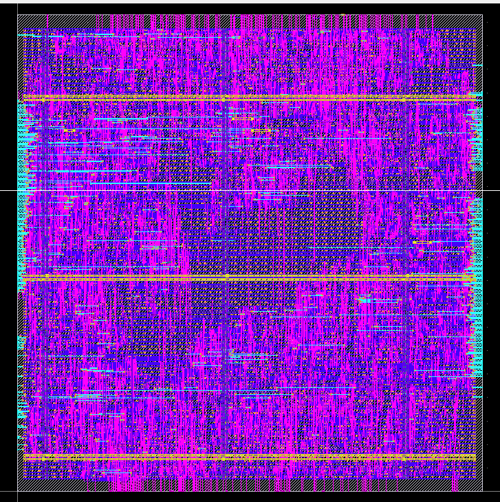

# 4×4 Systolic Array AI Accelerator

<!-- ONE-LINE PITCH: what it is + the headline proof. Example shape:
     "An int8 matrix-multiply accelerator, verified against a NumPy golden model and taken
      from RTL to a DRC/LVS-clean SkyWater 130 nm layout." -->
_YOUR ONE-LINE PITCH HERE_

<!-- THE MOST IMPORTANT THING ON THE PAGE: a picture.
     Put your LibreLane layout screenshot (or the block diagram) in docs/ and link it. -->


---

## Overview
<!-- Your abstract goes here (trim to 3–5 sentences).
     Answer: what problem, what you built, how you verified it, best numbers. -->

## Why a systolic array?
<!-- 2–3 sentences in your own words. Hint: what do a_out and b_out save?
     (Data reuse: each number is read once and passed along instead of re-fetched.) -->

## Architecture


<!-- Explain in a few bullets:
     - Inputs: A_in[31:0] (4 int8 rows), B_in[31:0] (4 int8 columns)
     - 16 identical PEs: acc += a*b, pass a right, pass b down
     - Output: acc_all[511:0] = 16 × 32-bit results
     - Latency: 3N − 2 = 10 cycles for a 4×4 -->

| Parameter | Value |
|---|---|
| Matrix size | 4×4 |
| Input format | int8 (signed) |
| Accumulator | 32-bit |
| Latency | 10 cycles |
| Target platforms | Zybo Z7-20 FPGA, SkyWater 130 nm ASIC |

## Verification
<!-- Describe the flow in 3 steps and show proof (paste the PASS output or a waveform screenshot):
     1. golden/golden_4x4.py makes random A, B and computes C = A @ B (NumPy)
     2. it writes the per-cycle input schedule + expected outputs to .mem files
     3. tb/tb_array_4x4.v feeds the array and checks all 16 outputs -->

```
PASS  acc #0 (row 0, col 0) = ...
...
=== ALL 16 PASSED: array matches NumPy ===
```

## Results (LibreLane, Sky130, sky130_fd_sc_hd)
<!-- Use numbers from a CLEAN run only (no setup violations in any corner). -->

| Metric | Value |
|---|---|
| Clock | ___ MHz |
| Setup slack (worst corner) | ___ ns |
| Standard cells | ___ |
| Std-cell area | ___ µm² |
| Die size | ___ × ___ µm |
| Power | ___ mW |
| DRC / LVS errors | 0 / 0 |

<!-- One or two sentences on the critical path and the PPA trade-off you saw
     (relaxing the clock reduced area and power). -->

## How to run
```bash
# 1. Make test data (golden model)
cd golden
python3 golden_4x4.py            # change SEED inside for a new random test

# 2. Simulate (Vivado): add rtl/ and tb/ to a project, set tb_array_4x4 as top,
#    update the $readmemh paths, then Run Behavioral Simulation

# 3. Build the layout (inside the IIC-OSIC-TOOLS Docker image)
cd asic
librelane config.yaml
```

## Repository structure
```
rtl/      pe.v, array_2x2.v, array_4x4.v
tb/       tb_pe.v, tb_array2x2.v, tb_array_4x4.v
golden/   golden_4x4.py
asic/     config.yaml, metrics, layout screenshots
docs/     diagrams, paper (PDF)
```

## Next steps
<!-- Keep this honest and short. -->
- [ ] 2×2 version taped out through Tiny Tapeout (SKY26d shuttle)
- [ ] Pipelined PE for a higher clock
- [ ] Zybo demo with Pcam (gesture recognition)
- [ ] Rover / drone integration

## Author
_Your name_ · _LinkedIn_ · _email_
